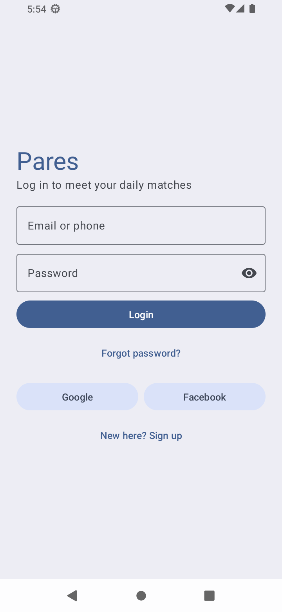
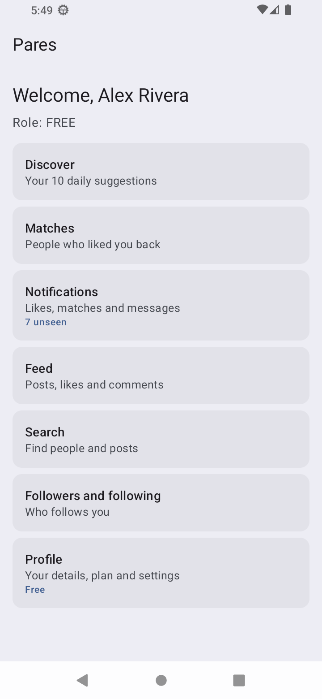
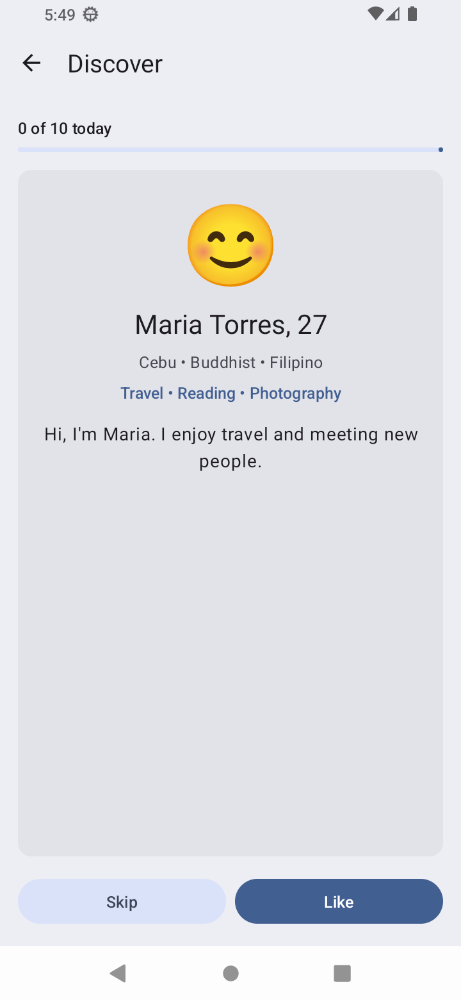
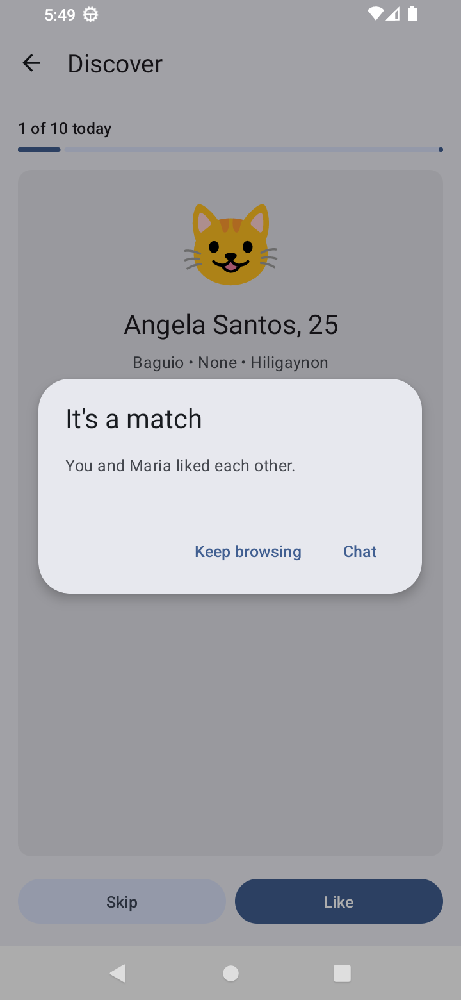
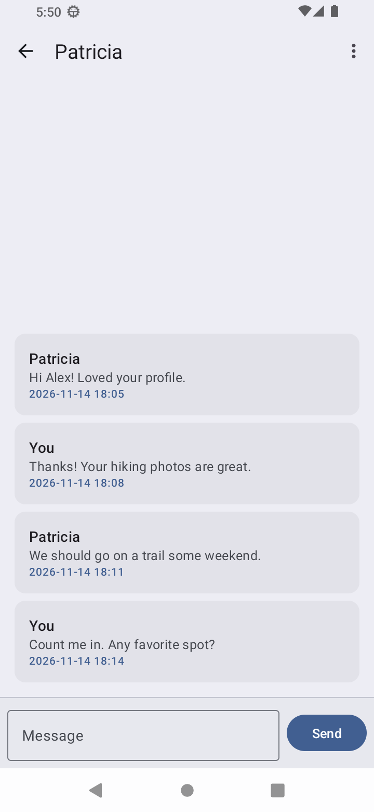
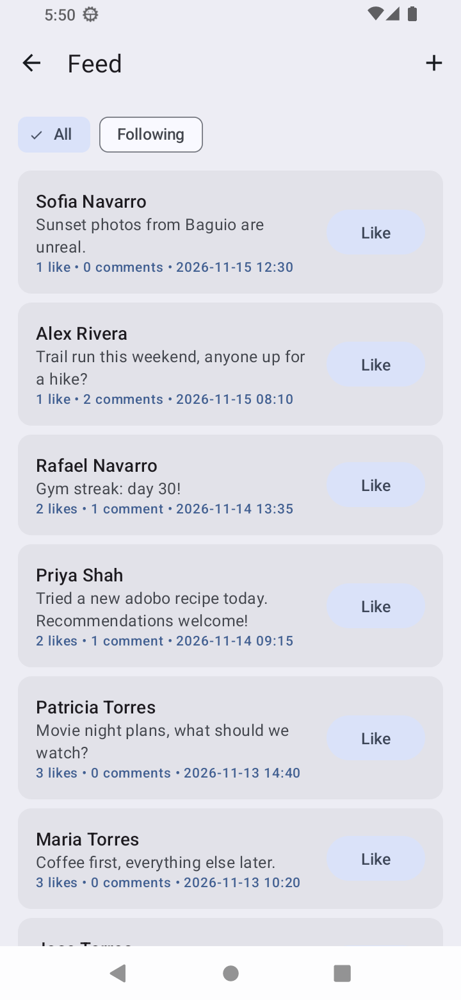
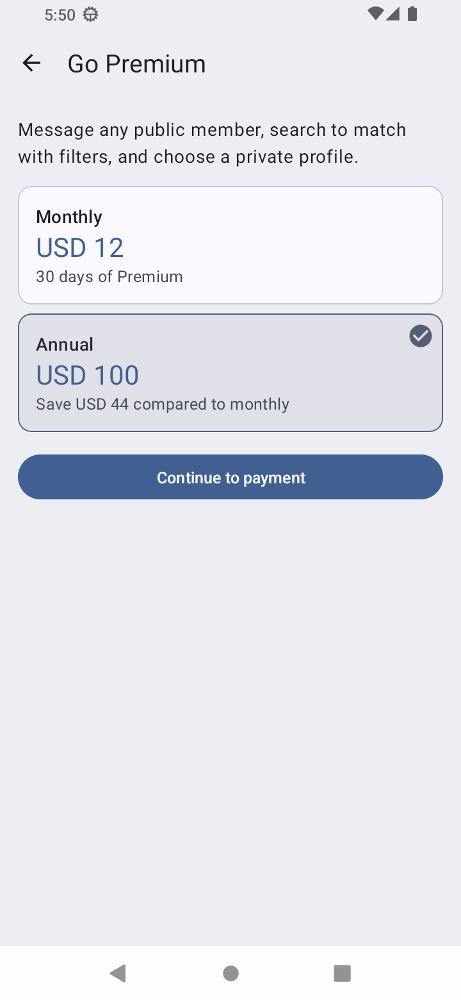
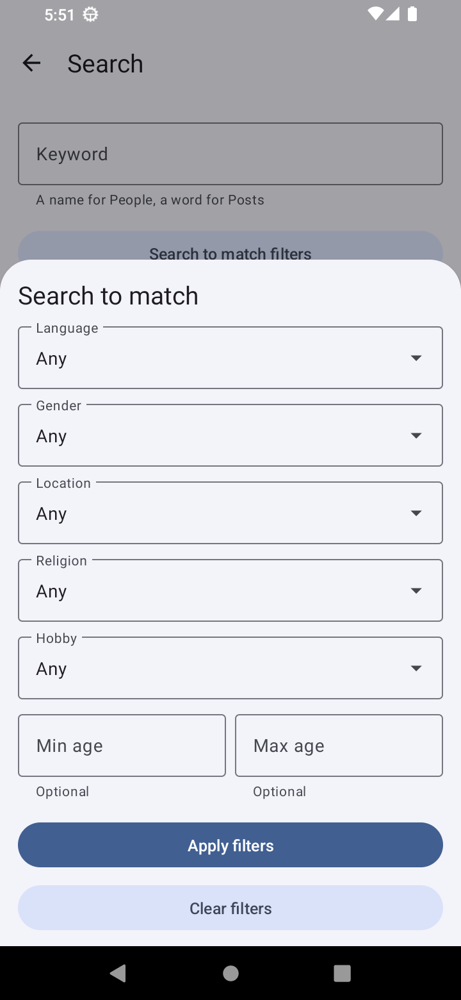
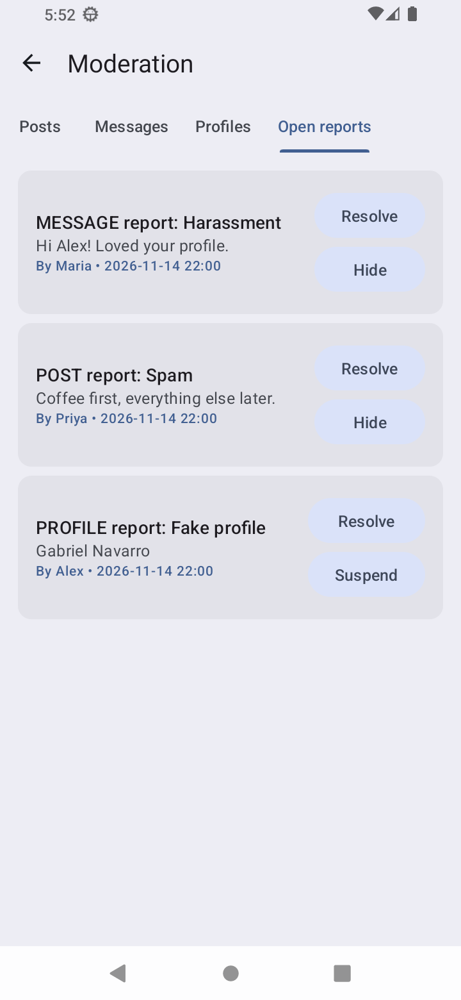

# Pares

An offline matchmaking and social networking Android app. Members sign up, set their preferences and get 10 match suggestions a day to Like or Skip. A mutual like becomes a match and opens a chat. Members can also post to a feed, follow each other, search, and upgrade to Premium. An admin moderates users, content and reports. The whole app works offline with no backend.

**Core flow:** Sign up → Set preferences → Daily 10 suggestions (Like/Skip) → Mutual match → Chat

**Admin flow:** Logs in → Manages users / Moderates posts, messages and profiles / Resolves reports / Reads the analytics

## About

Pares is a practice project for the Tagisan ng Talino (TNT) 2024 - 2025 Code Fest hackathon. It is a simulation: everything is stored on the device in SQLite, and there is no server, payment gateway, email, SMS, social login provider or real push notification.

| | |
|---|---|
| Team Name | Yukinians |
| Team Members | [Vrixzandro Eliponga](https://github.com/mowtiie), [Michael Tagle](https://github.com/ImmunoCapacity), [Xean Stephen Atatado](https://github.com/771Folders) |

## Features

**Registration and authentication**
- Sign up as a free member with a first name, last name, email, phone number and password. Names are required, the email must be valid and unique, the phone number is 10 to 13 digits and unique, and the password is at least 6 characters
- Log in with an email or a phone number plus a password, with a show/hide toggle on the password. The stored account decides which home screen opens, the member home or the admin home. A suspended account cannot log in and sees a message
- Forgot password resets the password for an email that exists
- Google and Facebook are fake buttons that sign in a seeded demo account

**Members (Free and Premium)**
- Edit Profile sets an avatar emoji, first and last name, age, gender, location, religion, language, bio and hobbies from a fixed list
- Preferences set the gender, age range, location, religion, language and hobbies you are looking for
- Discover gives 10 suggestions a day, one card at a time, with a Like and a Skip button and an "n of 10 today" progress bar. Candidates are filtered by your preferred gender and age range, ranked by shared language, location, religion and hobbies, and never include blocked, matched or already suggested people. After 10 actions it asks you to come back tomorrow
- A mutual like creates a match, notifies both people and shows an "It's a match" dialog with a Chat button
- Matches lists your active matches with the last message. Chat shows the conversation with a sticky input bar, and a seeded member answers with a canned reply after a moment
- Notifications list likes, matches and messages newest first, mark unseen ones as new, and the member home shows the unseen count
- Feed shows posts newest first with All and Following filters. Like a post, comment on it in a bottom sheet, write a new post and delete your own posts with an Undo
- Profile View shows another member and lets you follow or unfollow, chat (matches only on Free), report with a reason, block or unmatch, each with an Undo where it applies. Followers and Following are tabs on one screen
- Search finds People by name and Posts by keyword, and Free members can view and follow from the results
- Profile shows your details and lets you edit your profile and preferences, upgrade, or log out

**Premium**
- Premium upgrade shows two plans, Monthly (USD 12) and Annual (USD 100)
- Payment offers Online payment, E-wallet, Debit card or Credit card. Cards validate a 16 digit number, an MM/YY expiry and a 3 digit CVV, E-wallet validates a mobile number and Online payment validates an email. A short processing overlay is followed by success, and the plan and expiry show on the profile
- A Private profile switch hides a Premium profile from suggestions, search and the feed, and only matches can open it
- Premium members can message any public member from their profile
- Search to match adds filters for language, gender, location, religion, hobby and age range, and a Like button on each result that uses the same mutual match logic. Free members see it locked with an Upgrade action

**Admin**
- Users is a searchable list of all members with their role and status. Suspend or activate a member, or delete one, each with an Undo
- Moderation has tabs for Posts, Messages, Profiles and Open reports. Hide or unhide posts and messages, clear a bio, suspend a user and resolve reports, each with an Undo
- Analytics shows the total matches, matches today, total users, free users, premium users, total posts and total messages
- Reports shows new free members today, new premium members today, and the full lists of free and premium members

**Messages**
- Every action gets feedback: account created, wrong login, suspended account, match, report sent, user blocked (with Undo), payment successful and content hidden, with inline errors on the wrong field
- Notifications are in-app only, with no Android notifications or channels

## Tech specs

| | |
|---|---|
| Language | Java 11 |
| UI | XML layouts, Material Design 3 (Material Components 1.14), view binding |
| Min / target SDK | 29 (Android 10) / 36 |
| Build | Android Gradle Plugin 9.2.1 |
| Storage | Local SQLite for users, swipes, matches, messages, posts, post likes, comments, follows, blocks, reports, notifications and payments |
| Media | Avatars are emoji picked in the app, no gallery or camera and no permissions needed |
| Theme | Material Theme Builder palette, light and dark |
| Navigation | One Activity per screen, no fragments |
| Libraries | AndroidX AppCompat, Activity, ConstraintLayout and Material Components only |

## Requirements

- Android Studio (a recent version that supports AGP 9.x) and JDK 11 or newer
- An Android emulator or device running Android 10 (API 29) or higher

## Getting started

```bash
git clone https://github.com/mowtiie/Pares.git
cd Pares
./gradlew assembleDebug
```

Then open the project in Android Studio and press **Run** on an emulator. The debug APK is created at `app/build/outputs/apk/debug/`.

## Demo accounts

Demo data is seeded when the database is first created, so you can log in and look around without adding anything.

| Email | Password | Role | Data |
|---|---|---|---|
| `free@demo.com` | `demo1234` | Free member | 5 members who already liked you, 2 matches with chat history and a few notifications |
| `premium@demo.com` | `demo1234` | Premium member | 2 matches with chat history, 3 members who already liked you and an Annual plan |
| `admin@demo.com` | `demo1234` | Admin | The user list, 3 open reports, the moderation tools and the analytics |
| `social@demo.com` | `demo1234` | Free member | The account the fake Google and Facebook buttons sign in |

The seed also adds 32 members with varied age, gender, location, religion, language and hobbies, 8 posts with likes and comments, follows and payments. You can also create your own free account on the sign up screen.

## Notes

- Data is saved in local SQLite and persists across restarts.
- The database is recreated when its version changes, so upgrading across a schema change clears the saved data.
- Accounts are simulated. Passwords are stored as plain text in the local database, so do not use a real password.
- Only free members sign up. A member becomes Premium through the Payment screen, and the admin account is seeded.
- There is no downgrade or cancel flow for Premium, and payments always succeed.
- Members who already liked you rank first in Discover, so a live mutual match always shows up in a demo.
- Likes sent from Search to match do not count toward the daily 10.

## Screenshots

<div align="center">
	<div>
         
         
         
         
         
         
         
         
         
	</div>
</div>

## Release build

```bash
./gradlew assembleRelease
```

Release builds are minified and shrunk. To sign them, create a `keystore.properties` file in the project root with your keystore path, alias and passwords:

```
storeFile=path/to/your.jks
storePassword=your-store-password
keyAlias=your-alias
keyPassword=your-key-password
```

Without that file `assembleRelease` still builds, but the APK is unsigned (`app-release-unsigned.apk`). The signed APK is created at `app/build/outputs/apk/release/`.

Keystore files and `keystore.properties` are git-ignored and must never be committed.

## Verification

APK releases on GitHub are signed using my key. They can
be verified using
[apksigner](https://developer.android.com/studio/command-line/apksigner.html#options-verify):

```
apksigner verify --print-certs --verbose pares.apk
```

The output should look like:

```
Verifies
Verified using v1 scheme (JAR signing): false
Verified using v2 scheme (APK Signature Scheme v2): true
Verified using v3 scheme (APK Signature Scheme v3): false
Verified using v3.1 scheme (APK Signature Scheme v3.1): false
Verified using v3.2 scheme (APK Signature Scheme v3.2): false
Verified using v4 scheme (APK Signature Scheme v4): false
```

The certificate fingerprints should correspond to the ones listed below:

```
Owner: CN=Mowtiie
Issuer: CN=Mowtiie
Serial number: 8a256fdcdde50069
Valid from: Wed Jun 10 22:57:23 PST 2026 until: Sun Oct 26 22:57:23 PST 2053
Certificate fingerprints:
         SHA1: 56:4E:2C:DB:E4:06:C9:EC:15:E6:BC:D9:0A:88:38:72:8B:FB:13:20
         SHA256: 8B:67:51:F3:C3:31:85:63:5F:98:95:30:B6:C0:73:A1:39:7B:3D:41:2B:EF:AE:69:06:A2:EB:58:45:D2:DE:63
```

**Warning:** Only install Pares APKs signed with the key above. Verifying the signature confirms you're running a genuine, unmodified build.

### PGP Signing

As an additional layer on top of the Android signature above, each release is also signed with my PGP key. While `apksigner` confirms the APK itself is intact, a PGP signature confirms that *I* am the one who published this specific file to GitHub — an independent check that doesn't rely on GitHub's account security alone.

**Public key fingerprint:**
```
9EA2 8F46 7802 5092 7643 1B69 42B5 FA42 AA63 90E1
```

Download and import the key from my website, or directly from this repo:

```
curl -O https://mowtiie.cc/PGP_PUBLIC_KEY.asc
gpg --import PGP_PUBLIC_KEY.asc
```

After importing, confirm the fingerprint printed by GPG matches the one listed above — that match is what actually establishes trust, not the import step itself. Fetching the key over HTTPS from a domain you already trust is arguably a stronger anchor than a keyserver, since keyservers accept uploads from anyone and don't vouch for identity.

Each release includes a detached `.asc` signature alongside the APK. Verify a downloaded release with:

```
gpg --verify pares-X.X.apk.asc pares-X.X.apk
```

A valid signature looks like:

```
Good signature from "Mowtiie <mowtiie.dev@gmail.com>"
```

**Note:** PGP signing is a supplementary trust measure, not a substitute for the `apksigner` check above — verify both if you want the highest confidence that a release is genuine and unmodified.

## License

Pares is released under the [MIT License](LICENSE).
